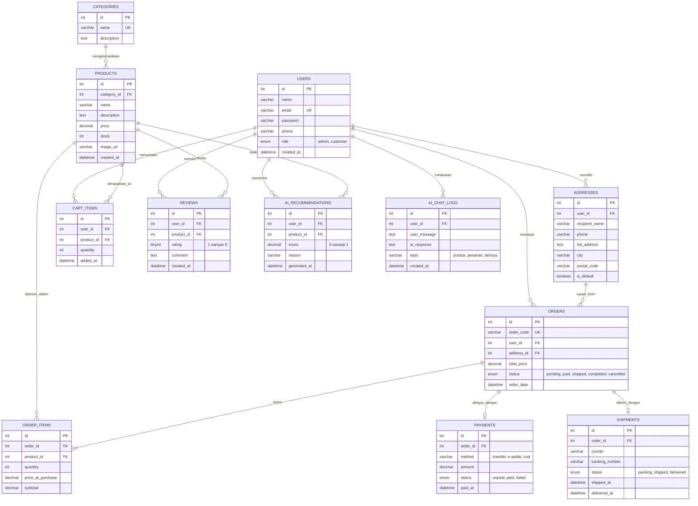

# ERD Sistem E-Commerce dengan Fitur AI

**Proyek Uji Kompetensi Keahlian (UKK)**

| | |
|---|---|
| **Nama Siswa** | ................................ |
| **Kelas / Kompetensi Keahlian** | ................................ |
| **Database** | MySQL / MariaDB |
| **Tanggal** | ................................ |

---

## 1. Deskripsi Singkat Sistem

Sistem e-commerce yang memungkinkan **pelanggan** melihat produk, memasukkan ke keranjang, melakukan pemesanan, membayar, dan memantau pengiriman. **Admin** mengelola kategori, produk, dan pesanan.

Sistem juga memiliki dua **fitur AI**:

1. **Rekomendasi Produk**: sistem menyarankan produk yang sesuai dengan minat pelanggan.
2. **Chatbot Asisten Belanja**: pelanggan dapat bertanya seputar produk dan status pesanan, dan riwayat percakapan disimpan.

---

## 2. Daftar Entitas

| No | Entitas | Fungsi |
|---|---|---|
| 1 | `users` | Data akun pelanggan dan admin |
| 2 | `addresses` | Alamat pengiriman milik user |
| 3 | `categories` | Kategori produk |
| 4 | `products` | Data produk |
| 5 | `cart_items` | Isi keranjang belanja |
| 6 | `orders` | Data pesanan (header) |
| 7 | `order_items` | Detail produk dalam pesanan |
| 8 | `payments` | Data pembayaran |
| 9 | `shipments` | Data pengiriman |
| 10 | `reviews` | Ulasan dan rating produk |
| 11 | `ai_recommendations` | Hasil rekomendasi produk dari AI |
| 12 | `ai_chat_logs` | Riwayat percakapan chatbot AI |

---

## 3. ERD



---

## 4. Relasi Antar Tabel

| Tabel Induk | Tabel Anak | Kardinalitas | Keterangan |
|---|---|---|---|
| users | addresses | 1 : N | Satu user punya banyak alamat |
| users | orders | 1 : N | Satu user dapat membuat banyak pesanan |
| users | cart_items | 1 : N | Satu user punya banyak item keranjang |
| users | reviews | 1 : N | Satu user dapat menulis banyak ulasan |
| users | ai_recommendations | 1 : N | Satu user menerima banyak rekomendasi |
| users | ai_chat_logs | 1 : N | Satu user punya banyak riwayat chat |
| categories | products | 1 : N | Satu kategori memuat banyak produk |
| products | order_items | 1 : N | Satu produk bisa ada di banyak pesanan |
| products | reviews | 1 : N | Satu produk memiliki banyak ulasan |
| orders | order_items | 1 : N | Satu pesanan berisi minimal satu produk |
| orders | payments | 1 : 1 | Satu pesanan punya satu pembayaran |
| orders | shipments | 1 : 1 | Satu pesanan punya satu pengiriman |
| addresses | orders | 1 : N | Satu alamat dapat dipakai di banyak pesanan |

> **Catatan:** `users` dan `products` memiliki hubungan **N : M** melalui tabel perantara `cart_items`, `order_items`, dan `reviews`.

---

## 5. Kamus Data (Data Dictionary)

### 5.1 users

| Kolom | Tipe Data | Key | Keterangan |
|---|---|---|---|
| id | INT AUTO_INCREMENT | PK | ID user |
| name | VARCHAR(100) | | Nama lengkap |
| email | VARCHAR(100) | UK | Email, tidak boleh sama |
| password | VARCHAR(255) | | Password ter-hash |
| phone | VARCHAR(20) | | Nomor telepon |
| role | ENUM('admin','customer') | | Hak akses |
| created_at | DATETIME | | Waktu daftar |

### 5.2 addresses

| Kolom | Tipe Data | Key | Keterangan |
|---|---|---|---|
| id | INT AUTO_INCREMENT | PK | ID alamat |
| user_id | INT | FK → users.id | Pemilik alamat |
| recipient_name | VARCHAR(100) | | Nama penerima |
| phone | VARCHAR(20) | | Telepon penerima |
| full_address | TEXT | | Alamat lengkap |
| city | VARCHAR(50) | | Kota |
| postal_code | VARCHAR(10) | | Kode pos |
| is_default | BOOLEAN | | Alamat utama atau bukan |

### 5.3 categories

| Kolom | Tipe Data | Key | Keterangan |
|---|---|---|---|
| id | INT AUTO_INCREMENT | PK | ID kategori |
| name | VARCHAR(100) | UK | Nama kategori |
| description | TEXT | | Deskripsi |

### 5.4 products

| Kolom | Tipe Data | Key | Keterangan |
|---|---|---|---|
| id | INT AUTO_INCREMENT | PK | ID produk |
| category_id | INT | FK → categories.id | Kategori produk |
| name | VARCHAR(150) | | Nama produk |
| description | TEXT | | Deskripsi |
| price | DECIMAL(12,2) | | Harga |
| stock | INT | | Jumlah stok |
| image_url | VARCHAR(255) | | Lokasi gambar |
| created_at | DATETIME | | Waktu ditambahkan |

### 5.5 cart_items

| Kolom | Tipe Data | Key | Keterangan |
|---|---|---|---|
| id | INT AUTO_INCREMENT | PK | ID item keranjang |
| user_id | INT | FK → users.id | Pemilik keranjang |
| product_id | INT | FK → products.id | Produk |
| quantity | INT | | Jumlah |
| added_at | DATETIME | | Waktu ditambahkan |

### 5.6 orders

| Kolom | Tipe Data | Key | Keterangan |
|---|---|---|---|
| id | INT AUTO_INCREMENT | PK | ID pesanan |
| order_code | VARCHAR(30) | UK | Kode pesanan, contoh: ORD-20261112-001 |
| user_id | INT | FK → users.id | Pemesan |
| address_id | INT | FK → addresses.id | Alamat tujuan |
| total_price | DECIMAL(12,2) | | Total harga |
| status | ENUM('pending','paid','shipped','completed','cancelled') | | Status pesanan |
| order_date | DATETIME | | Tanggal pesan |

### 5.7 order_items

| Kolom | Tipe Data | Key | Keterangan |
|---|---|---|---|
| id | INT AUTO_INCREMENT | PK | ID detail |
| order_id | INT | FK → orders.id | Pesanan |
| product_id | INT | FK → products.id | Produk |
| quantity | INT | | Jumlah |
| price_at_purchase | DECIMAL(12,2) | | Harga saat dibeli (tidak berubah walau harga produk berubah) |
| subtotal | DECIMAL(12,2) | | quantity × price_at_purchase |

### 5.8 payments

| Kolom | Tipe Data | Key | Keterangan |
|---|---|---|---|
| id | INT AUTO_INCREMENT | PK | ID pembayaran |
| order_id | INT | FK, UK → orders.id | Pesanan |
| method | VARCHAR(30) | | Metode bayar |
| amount | DECIMAL(12,2) | | Jumlah dibayar |
| status | ENUM('unpaid','paid','failed') | | Status bayar |
| paid_at | DATETIME | | Waktu bayar |

### 5.9 shipments

| Kolom | Tipe Data | Key | Keterangan |
|---|---|---|---|
| id | INT AUTO_INCREMENT | PK | ID pengiriman |
| order_id | INT | FK, UK → orders.id | Pesanan |
| courier | VARCHAR(50) | | Nama kurir |
| tracking_number | VARCHAR(50) | | Nomor resi |
| status | ENUM('packing','shipped','delivered') | | Status kirim |
| shipped_at | DATETIME | | Waktu dikirim |
| delivered_at | DATETIME | | Waktu diterima |

### 5.10 reviews

| Kolom | Tipe Data | Key | Keterangan |
|---|---|---|---|
| id | INT AUTO_INCREMENT | PK | ID ulasan |
| user_id | INT | FK → users.id | Penulis |
| product_id | INT | FK → products.id | Produk |
| rating | TINYINT | | 1 sampai 5 |
| comment | TEXT | | Isi ulasan |
| created_at | DATETIME | | Waktu ulasan |

### 5.11 ai_recommendations

| Kolom | Tipe Data | Key | Keterangan |
|---|---|---|---|
| id | INT AUTO_INCREMENT | PK | ID rekomendasi |
| user_id | INT | FK → users.id | Penerima rekomendasi |
| product_id | INT | FK → products.id | Produk yang disarankan |
| score | DECIMAL(3,2) | | Skor kecocokan (0 sampai 1) |
| reason | VARCHAR(255) | | Alasan, contoh: "Sering melihat kategori Sepatu" |
| generated_at | DATETIME | | Waktu dibuat |

### 5.12 ai_chat_logs

| Kolom | Tipe Data | Key | Keterangan |
|---|---|---|---|
| id | INT AUTO_INCREMENT | PK | ID log |
| user_id | INT | FK → users.id | Pengguna |
| user_message | TEXT | | Pertanyaan pengguna |
| ai_response | TEXT | | Jawaban AI |
| topic | VARCHAR(30) | | Topik percakapan |
| created_at | DATETIME | | Waktu chat |

---

## 6. Cara Kerja Fitur AI

### 6.1 Rekomendasi Produk

1. Sistem membaca riwayat pembelian (`order_items`), ulasan (`reviews`), dan isi keranjang (`cart_items`).
2. Sistem mencari produk dengan kategori atau pola yang mirip.
3. Hasil disimpan ke `ai_recommendations` beserta `score` dan `reason`.
4. Aplikasi menampilkan produk dengan skor tertinggi pada halaman beranda.

### 6.2 Chatbot Asisten Belanja

1. Pelanggan mengirim pertanyaan, misalnya "Di mana pesanan saya?".
2. Sistem mengambil data terkait (`orders`, `shipments`) milik **user tersebut saja**.
3. AI menyusun jawaban, lalu pertanyaan dan jawaban disimpan ke `ai_chat_logs`.

---

## 7. Script SQL (MySQL)

```sql
CREATE DATABASE ecommerce_ai;
USE ecommerce_ai;

CREATE TABLE users (
    id INT AUTO_INCREMENT PRIMARY KEY,
    name VARCHAR(100) NOT NULL,
    email VARCHAR(100) NOT NULL UNIQUE,
    password VARCHAR(255) NOT NULL,
    phone VARCHAR(20),
    role ENUM('admin','customer') NOT NULL DEFAULT 'customer',
    created_at DATETIME DEFAULT CURRENT_TIMESTAMP
);

CREATE TABLE addresses (
    id INT AUTO_INCREMENT PRIMARY KEY,
    user_id INT NOT NULL,
    recipient_name VARCHAR(100) NOT NULL,
    phone VARCHAR(20),
    full_address TEXT NOT NULL,
    city VARCHAR(50),
    postal_code VARCHAR(10),
    is_default BOOLEAN DEFAULT FALSE,
    FOREIGN KEY (user_id) REFERENCES users(id) ON DELETE CASCADE
);

CREATE TABLE categories (
    id INT AUTO_INCREMENT PRIMARY KEY,
    name VARCHAR(100) NOT NULL UNIQUE,
    description TEXT
);

CREATE TABLE products (
    id INT AUTO_INCREMENT PRIMARY KEY,
    category_id INT NOT NULL,
    name VARCHAR(150) NOT NULL,
    description TEXT,
    price DECIMAL(12,2) NOT NULL CHECK (price > 0),
    stock INT NOT NULL DEFAULT 0 CHECK (stock >= 0),
    image_url VARCHAR(255),
    created_at DATETIME DEFAULT CURRENT_TIMESTAMP,
    FOREIGN KEY (category_id) REFERENCES categories(id)
);

CREATE TABLE cart_items (
    id INT AUTO_INCREMENT PRIMARY KEY,
    user_id INT NOT NULL,
    product_id INT NOT NULL,
    quantity INT NOT NULL DEFAULT 1 CHECK (quantity > 0),
    added_at DATETIME DEFAULT CURRENT_TIMESTAMP,
    UNIQUE (user_id, product_id),
    FOREIGN KEY (user_id) REFERENCES users(id) ON DELETE CASCADE,
    FOREIGN KEY (product_id) REFERENCES products(id)
);

CREATE TABLE orders (
    id INT AUTO_INCREMENT PRIMARY KEY,
    order_code VARCHAR(30) NOT NULL UNIQUE,
    user_id INT NOT NULL,
    address_id INT NOT NULL,
    total_price DECIMAL(12,2) NOT NULL,
    status ENUM('pending','paid','shipped','completed','cancelled') DEFAULT 'pending',
    order_date DATETIME DEFAULT CURRENT_TIMESTAMP,
    FOREIGN KEY (user_id) REFERENCES users(id),
    FOREIGN KEY (address_id) REFERENCES addresses(id)
);

CREATE TABLE order_items (
    id INT AUTO_INCREMENT PRIMARY KEY,
    order_id INT NOT NULL,
    product_id INT NOT NULL,
    quantity INT NOT NULL CHECK (quantity > 0),
    price_at_purchase DECIMAL(12,2) NOT NULL,
    subtotal DECIMAL(12,2) NOT NULL,
    FOREIGN KEY (order_id) REFERENCES orders(id) ON DELETE CASCADE,
    FOREIGN KEY (product_id) REFERENCES products(id)
);

CREATE TABLE payments (
    id INT AUTO_INCREMENT PRIMARY KEY,
    order_id INT NOT NULL UNIQUE,
    method VARCHAR(30) NOT NULL,
    amount DECIMAL(12,2) NOT NULL,
    status ENUM('unpaid','paid','failed') DEFAULT 'unpaid',
    paid_at DATETIME,
    FOREIGN KEY (order_id) REFERENCES orders(id) ON DELETE CASCADE
);

CREATE TABLE shipments (
    id INT AUTO_INCREMENT PRIMARY KEY,
    order_id INT NOT NULL UNIQUE,
    courier VARCHAR(50),
    tracking_number VARCHAR(50),
    status ENUM('packing','shipped','delivered') DEFAULT 'packing',
    shipped_at DATETIME,
    delivered_at DATETIME,
    FOREIGN KEY (order_id) REFERENCES orders(id) ON DELETE CASCADE
);

CREATE TABLE reviews (
    id INT AUTO_INCREMENT PRIMARY KEY,
    user_id INT NOT NULL,
    product_id INT NOT NULL,
    rating TINYINT NOT NULL CHECK (rating BETWEEN 1 AND 5),
    comment TEXT,
    created_at DATETIME DEFAULT CURRENT_TIMESTAMP,
    UNIQUE (user_id, product_id),
    FOREIGN KEY (user_id) REFERENCES users(id) ON DELETE CASCADE,
    FOREIGN KEY (product_id) REFERENCES products(id) ON DELETE CASCADE
);

CREATE TABLE ai_recommendations (
    id INT AUTO_INCREMENT PRIMARY KEY,
    user_id INT NOT NULL,
    product_id INT NOT NULL,
    score DECIMAL(3,2) NOT NULL CHECK (score BETWEEN 0 AND 1),
    reason VARCHAR(255),
    generated_at DATETIME DEFAULT CURRENT_TIMESTAMP,
    FOREIGN KEY (user_id) REFERENCES users(id) ON DELETE CASCADE,
    FOREIGN KEY (product_id) REFERENCES products(id) ON DELETE CASCADE
);

CREATE TABLE ai_chat_logs (
    id INT AUTO_INCREMENT PRIMARY KEY,
    user_id INT NOT NULL,
    user_message TEXT NOT NULL,
    ai_response TEXT NOT NULL,
    topic VARCHAR(30),
    created_at DATETIME DEFAULT CURRENT_TIMESTAMP,
    FOREIGN KEY (user_id) REFERENCES users(id) ON DELETE CASCADE
);
```

---

## 8. Contoh Data (Sample)

```sql
INSERT INTO users (name, email, password, phone, role) VALUES
('Admin Toko', 'admin@toko.com', 'hash_admin', '081200000001', 'admin'),
('Budi Santoso', 'budi@mail.com', 'hash_budi', '081200000002', 'customer');

INSERT INTO categories (name, description) VALUES
('Elektronik', 'Perangkat elektronik'),
('Fashion', 'Pakaian dan aksesori');

INSERT INTO products (category_id, name, description, price, stock) VALUES
(1, 'Headphone Bluetooth', 'Headphone nirkabel', 250000, 50),
(2, 'Kaos Polos', 'Kaos katun nyaman', 75000, 100);

INSERT INTO addresses (user_id, recipient_name, phone, full_address, city, postal_code, is_default) VALUES
(2, 'Budi Santoso', '081200000002', 'Jl. Merdeka No. 10', 'Jakarta', '10110', TRUE);

INSERT INTO orders (order_code, user_id, address_id, total_price, status) VALUES
('ORD-20261112-001', 2, 1, 325000, 'paid');

INSERT INTO order_items (order_id, product_id, quantity, price_at_purchase, subtotal) VALUES
(1, 1, 1, 250000, 250000),
(1, 2, 1, 75000, 75000);

INSERT INTO payments (order_id, method, amount, status, paid_at) VALUES
(1, 'transfer', 325000, 'paid', NOW());

INSERT INTO ai_recommendations (user_id, product_id, score, reason) VALUES
(2, 2, 0.87, 'Sering membeli produk Fashion');
```

---

## 9. Contoh Query

**a. Daftar pesanan beserta nama pemesan**

```sql
SELECT o.order_code, u.name AS pemesan, o.total_price, o.status
FROM orders o
JOIN users u ON u.id = o.user_id
ORDER BY o.order_date DESC;
```

**b. Detail isi satu pesanan**

```sql
SELECT p.name AS produk, oi.quantity, oi.price_at_purchase, oi.subtotal
FROM order_items oi
JOIN products p ON p.id = oi.product_id
WHERE oi.order_id = 1;
```

**c. Produk terlaris**

```sql
SELECT p.name, SUM(oi.quantity) AS total_terjual
FROM order_items oi
JOIN products p ON p.id = oi.product_id
GROUP BY p.id, p.name
ORDER BY total_terjual DESC
LIMIT 5;
```

**d. Rata-rata rating per produk**

```sql
SELECT p.name, ROUND(AVG(r.rating), 1) AS rata_rating, COUNT(r.id) AS jumlah_ulasan
FROM products p
LEFT JOIN reviews r ON r.product_id = p.id
GROUP BY p.id, p.name;
```

**e. Rekomendasi AI untuk seorang user (skor tertinggi)**

```sql
SELECT p.name, ar.score, ar.reason
FROM ai_recommendations ar
JOIN products p ON p.id = ar.product_id
WHERE ar.user_id = 2
ORDER BY ar.score DESC
LIMIT 5;
```

**f. Total pendapatan per bulan (hanya pesanan yang sudah dibayar)**

```sql
SELECT DATE_FORMAT(paid_at, '%Y-%m') AS bulan, SUM(amount) AS pendapatan
FROM payments
WHERE status = 'paid'
GROUP BY bulan;
```

---

## 10. Aturan Bisnis

1. Email user tidak boleh sama dengan user lain.
2. Harga produk harus lebih dari 0 dan stok tidak boleh negatif.
3. Satu pesanan minimal berisi satu produk.
4. Harga saat pembelian disimpan di `order_items` agar riwayat tidak berubah jika harga produk diubah.
5. Satu user hanya boleh memberi satu ulasan per produk.
6. Rating hanya bernilai 1 sampai 5.
7. Stok berkurang otomatis saat pesanan dibayar.
8. Chatbot hanya boleh mengakses data pesanan milik user yang sedang login.

---

## 11. Kesimpulan

Rancangan database ini terdiri dari **12 tabel** yang saling berelasi, mencakup alur belanja dari pendaftaran, keranjang, pesanan, pembayaran, hingga pengiriman dan ulasan. Dua tabel AI (`ai_recommendations` dan `ai_chat_logs`) menambah fitur rekomendasi produk dan chatbot tanpa membuat struktur menjadi rumit.
